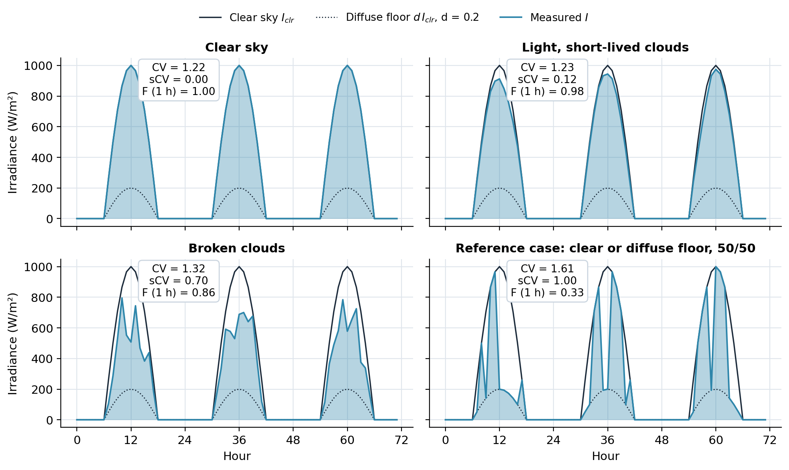
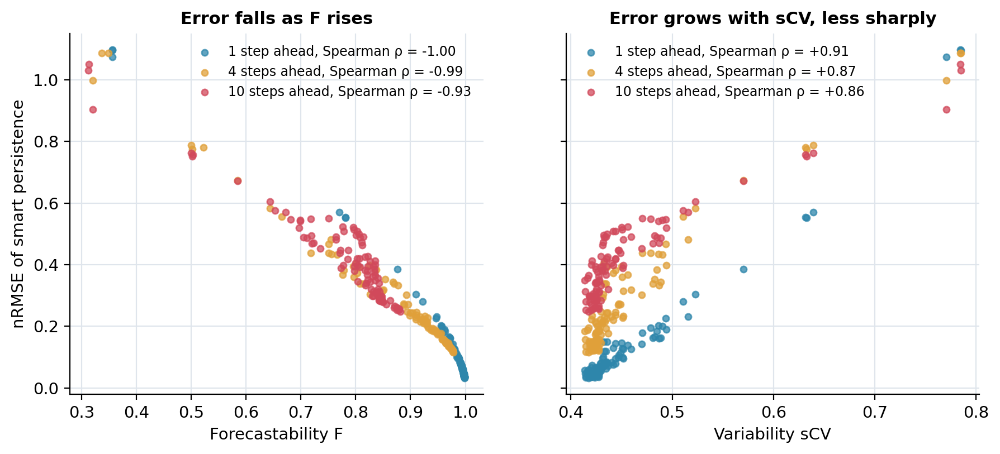
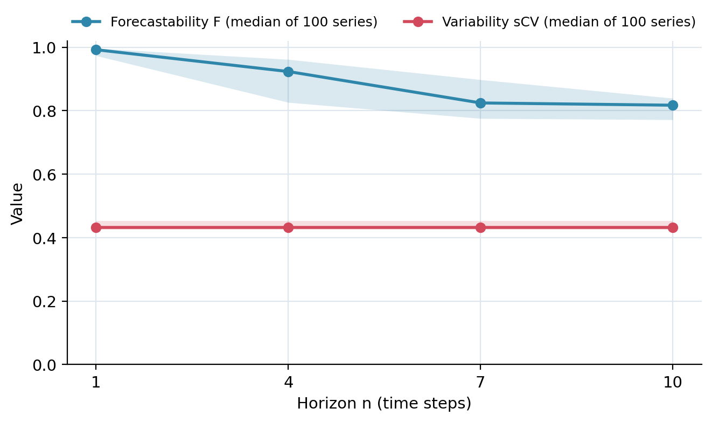

# solar-variability-scv

[](https://doi.org/10.5281/zenodo.23562553) (all versions; v1.0.0: [10.5281/zenodo.23562554](https://doi.org/10.5281/zenodo.23562554))

**How variable is the sun at a site, and how forecastable? Two numbers, sCV and F, with MATLAB code, worked examples and figures.**

> C. Voyant, A. Julien, M. Despotovic, G. Notton, L. A. Garcia-Gutierrez, C. F. Nicolosi, P. Blanc, J. Bright.
> *Stochastic coefficient of variation: Assessing the variability and forecastability of solar irradiance.*
> Renewable Energy 256 (2026) 123913. [doi:10.1016/j.renene.2025.123913](https://doi.org/10.1016/j.renene.2025.123913)

This repository gives clean functions for the definitions of the article (Eqs. 9–10 and 12–13), the article's own MATLAB scripts (`paper_scripts/`, unchanged) and a teaching demonstration built on the article's synthetic generator. It does not reproduce the experiments on the 68 SIAR stations, whose data are not included.

---

## The problem with the usual coefficient of variation

The coefficient of variation CV = σ / μ is the textbook measure of variability. For solar irradiance it mostly measures **the day**: the sun rises, culminates and sets, so even a perfectly clear sky has a large CV (1.22 in Figure 1). Two sites with the same clouds but different day lengths get different CVs.

What a forecaster needs is the part that the sun's course does not explain: the **clouds**. The stochastic coefficient of variation sCV measures the spread of irradiance **around the clear-sky curve**, not around the mean.

## Definitions

Let I(t) be the measured irradiance and I_clr(t) the clear-sky irradiance (the dynamic upper bound).

**Variability.** With a diffuse floor d (the fraction of clear sky that remains under a thick cloud, d = 0.2 in the article),

$$\mathrm{sCV} = \frac{\sqrt2}{|d-1|}\;\frac{\sqrt{\tfrac1n\sum_i \big(I(t_i)-I_{clr}(t_i)\big)^2}}{\sqrt{\sigma_{clr}^2+\mu_{clr}^2}} .$$

- The numerator is the **RMSE of the clear-sky model** used as a forecast of I.
- The denominator is the **root mean square of the clear-sky curve** (σ²_clr + μ²_clr is the mean of I_clr²).
- The factor √2 / |d − 1| sets the scale: **sCV = 0** when I follows clear sky, **sCV ≈ 1** for a long series where each hour is, with equal probability, clear or at the diffuse floor (the reference case of Figure 1).
- Night hours (I = I_clr = 0) add zero to both means: they do not change sCV.

**Forecastability.** With ε = I − I_clr and ρ(i) its autocorrelation at lag i,

$$\rho_{max} = \max_{i\in[n,\,T/2]} |\rho(i)|, \qquad F = 1 + \mathrm{sCV}\,(\rho_{max}-1),$$

where n is the forecast horizon in time steps and T the number of steps per day. F lies between 1 − sCV (clouds with no memory) and 1 (perfectly persistent clouds). It depends on the horizon; sCV does not.

**How to read them.**

| | low | high |
|---|---|---|
| sCV | the sky is mostly clear | the clouds move irradiance far from clear sky |
| F | hard to forecast at that horizon | easy to forecast at that horizon |

A cloudy site can be very forecastable if its clouds last (high sCV, high F); a site with fast, random clouds is not (high sCV, low F).

## Worked example by hand

Four daylight hours:

| hour | clear sky I_clr | measured I | I − I_clr |
|---|---:|---:|---:|
| 1 | 400 | 400 | 0 |
| 2 | 800 | 500 | −300 |
| 3 | 800 | 760 | −40 |
| 4 | 400 | 200 | −200 |

1. RMSE of clear sky: √((0 + 90 000 + 1 600 + 40 000) / 4) = √32 900 = **181.4 W/m²**
2. RMS of clear sky: √((160 000 + 640 000 + 640 000 + 160 000) / 4) = √400 000 = **632.5 W/m²**
3. sCV = √2 / 0.8 × 181.4 / 632.5 = 1.768 × 0.287 = **0.51**
4. If the residuals have ρ_max = 0.6 at the horizon of interest: F = 1 + 0.51 × (0.6 − 1) = **0.80**

```matlab
s = scv([400 500 760 200], [400 800 800 400])   % 0.5070
F = 1 + s * (0.6 - 1)                            % 0.7972
```

**What the value 1 means.** sCV is normalised on a reference sky that switches at random, half of the time, between clear sky and the diffuse floor d·I_clr: for that sky the mean of sCV² is 1, so a long series gives sCV ≈ 1 (1.00 in Figure 1). A clear sky gives 0. The value 1 is therefore a **reference of strong variability, not a mathematical maximum**: even with d·I_clr ≤ I ≤ I_clr, a sky that stays at the diffuse floor all the time gives √2 ≈ 1.41. The article calls sCV bounded within its working assumptions and notes that such persistent overcast periods count as highly variable although nothing changes, and are rare over a year of data (Section 4.1). The code does not clip the value. Compute sCV over at least a year, as the article does.

## Demonstration

```matlab
demo_scv                 % MATLAB: writes results/*.csv (about 20 s)
```
```bash
python make_figures.py   # draws figures/*.png and *.pdf
```



**Figure 1.** The same clear-sky cycle (6 h to 18 h, peak 1000 W/m²) under four skies. The classical CV hardly moves (1.22 for a clear sky, 1.23 with light clouds) because it is dominated by the daily cycle. sCV goes from 0 (clear) to 0.12 (light clouds), 0.70 (broken clouds) and 1.00 (the reference case, clear or diffuse floor at random each hour). F one hour ahead drops from 1 to 0.33: random switching between clear and overcast has no memory to exploit.

The Monte Carlo part uses the generator of the article's scripts: clear sky max(0, 1000 sin(2πt/T)), noise 1 + N(0, 1) bounded to [0.2, 1.1], smoothed by a causal moving average of random length (1 to T steps), random period T, 500 cycles per series, 100 series, horizons of 1, 4, 7 and 10 steps. T is drawn in [20, 100] instead of [12, 100] so that the lag range [n, T/2] is never empty up to n = 10.



**Figure 2.** Error of smart persistence against F (left) and against sCV (right). F ranks the 100 series almost perfectly at every horizon (Spearman ρ = −1.00, −0.99 and −0.93 at 1, 4 and 10 steps), and **it puts all horizons on the same curve**: a given F means a given difficulty, whatever the horizon. sCV ranks the series less well (ρ ≈ 0.86 to 0.91) and needs one curve per horizon, because it describes the site, not the forecasting task. This is the article's conclusion: F is the better predictor of forecast error, sCV the better description of variability.



**Figure 3.** Median over the 100 series (bands: interquartile range). sCV is a property of the series (median 0.43 here) and does not depend on the horizon. F decreases from 0.99 one step ahead to 0.82 at ten steps, as the noise loses memory: the further ahead, the less of the variability can be anticipated.

## Files

| file | role |
|---|---|
| `scv.m` | sCV of a series (Eq. 10), diffuse floor d = 0.2 by default; NaN samples excluded; errors on Inf, invalid d or an all-zero clear sky; no clipping |
| `forecastability.m` | F at horizon n (Eqs. 12–13), with ρ_max and the lag where it is reached; integer T and n with 1 ≤ n ≤ T/2; lags with fewer than 3 pairs or zero variance are ignored |
| `demo_scv.m` | the demonstration above; writes `results/*.csv` |
| `make_figures.py` | draws `figures/` (numpy, pandas, matplotlib) |
| `paper_scripts/` | the article's MATLAB scripts, unchanged (SHA-256 in `paper_scripts_SHA256.txt`): `main.m` (one series), `Plot_Horizon.m` (horizons), `boxplot.m` (Monte Carlo), `dephasage.m` (phase shifts), with the persistence and periodic AR forecasts they call |

About `paper_scripts/`: they use `autocorr` (Econometrics Toolbox) and take ρ_max as the largest autocorrelation over the lags [n, T/2]; the article's text specifies the largest absolute value. `forecastability.m` follows the text; for irradiance residuals the largest autocorrelation is positive and both give the same F. `boxplot.m` has the name of a MATLAB function: run it from its folder, or rename your copy.

Base MATLAB R2021a or later, no toolbox, for the functions and the demonstration. Python 3 with numpy, pandas and matplotlib for the figures.

**Using your own data.** Give `scv` and `forecastability` the measured global horizontal irradiance and a clear-sky estimate on the same timestamps (for example McClear from the Copernicus Atmosphere Monitoring Service, or a clear-sky model of your choice). Use a time step of a few minutes or more (the article advises against sub-minute data, where sensor response and over-irradiance distort the variability), and at least a year of data so that seasonal effects average out.

## Related

- Guide with more context: [cyrilvoyant.github.io](https://cyrilvoyant.github.io/) (methods and code)
- Normalised forecast errors against persistence: [nice-metrics](https://github.com/cyrilvoyant/nice-metrics)
- Persistence references for cyclostationary series: [cyclostationary-forecasting-matlab](https://github.com/cyrilvoyant/cyclostationary-forecasting-matlab)

## Machine-readable scientific documentation

The [use contract](llm.md) explains units, sampling, missing values and why sCV is not capped at one. The [documentation descriptor](websemantic.json) is not a deployed WebSemantic adapter. Equivalent linked data are provided as [Turtle](ontology/solar-variability-scv.ttl) and [JSON-LD](ontology/solar-variability-scv.jsonld).

## Citation and license

Please cite the article above (see `CITATION.cff`). Code under the MIT license.
